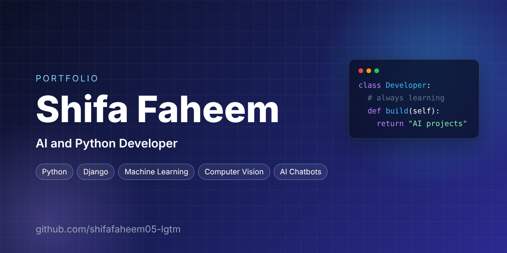

   

### Hi, I'm Shifa 👋

I'm an aspiring **AI and Python Developer** interested in building practical software applications, intelligent systems and automation tools. I enjoy solving real-world problems and learning new technologies.

I'm open to **remote opportunities, internships and freelance collaborations**.

---

### 🚀 Featured Projects

| Project | Description | Tech |
|---|---|---|
| [Django Attendance Management System](https://github.com/shifafaheem05-lgtm/django-attendance-management-system) | Student attendance app with teacher login, attendance marking, percentage reports, low-attendance warnings, charts and CSV export | Python, Django, SQLite, Bootstrap |
| [Floral Studio](https://floral-studio-gray.vercel.app/) | Live website for a floral and handmade-products concept | Web development |

---

### 🛠️ Skills

- **Languages and web:** Python, HTML, CSS
- **Frameworks and tools:** Django, Bootstrap, SQLite, Git, GitHub
- **Interests and learning:** Machine Learning, Deep Learning, Computer Vision, AI Chatbots, AI Automation

---

### 📫 Connect with me

- LinkedIn: [linkedin.com/in/shifa-faheem-dev](https://www.linkedin.com/in/shifa-faheem-dev)
- Portfolio: [floral-studio-gray.vercel.app](https://floral-studio-gray.vercel.app/)
